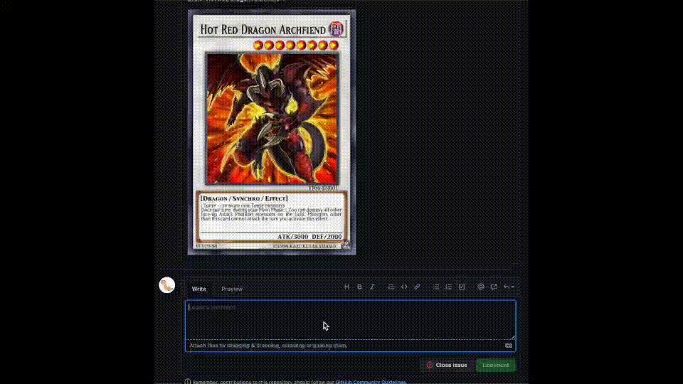

# draw-action

Draw Yu-Gi-Oh! Card on GitHub issue.



It takes about 10 seconds to draw.

## Inputs

### `github-token`

**Required** The GitHub token used to create an authenticated client.

## Example usage

```yaml
name: Draw Yu-Gi-Oh! Card
on:
  issue_comment:
    types: [created, edited]

jobs:
  draw:
    runs-on: ubuntu-latest
    steps:
      - name: Draw Yu-Gi-Oh! Card on GitHub issue
        uses: Doarakko/draw-action@main
        if: >-
          contains(github.event.comment.body, 'draw')
          || contains(github.event.comment.body, 'ドロー')
        with:
          github-token: ${{secrets.GITHUB_TOKEN}}
```

## Demo

Please comment "draw" to [this issue](https://github.com/Doarakko/draw-action/issues/1)!

## Privacy

This Action contacts Chainguard's licensing server to verify authorization. Connection metadata (IP address, GitHub repository identifier, timestamp, and any metadata encoded in the auth token) is transmitted to Chainguard, Inc. even if authorization is denied in accordance with our [Privacy Notice](https://www.chainguard.dev/legal/privacy-notice)
